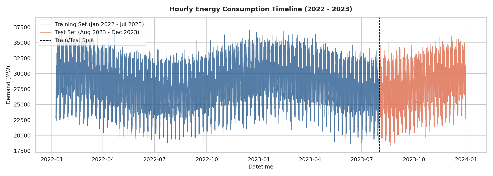
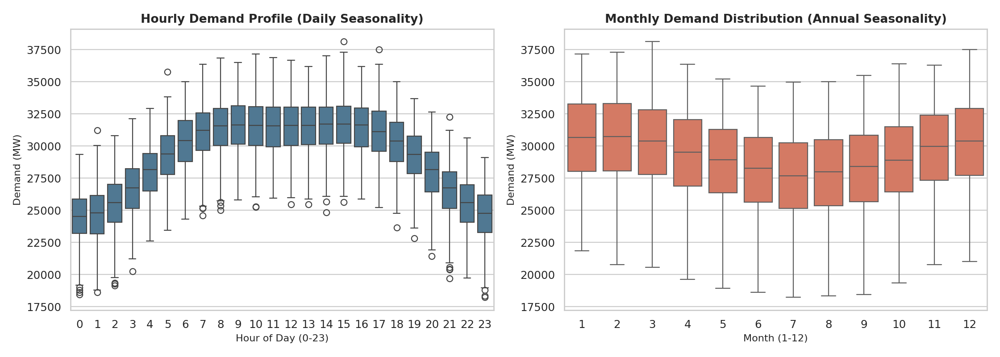
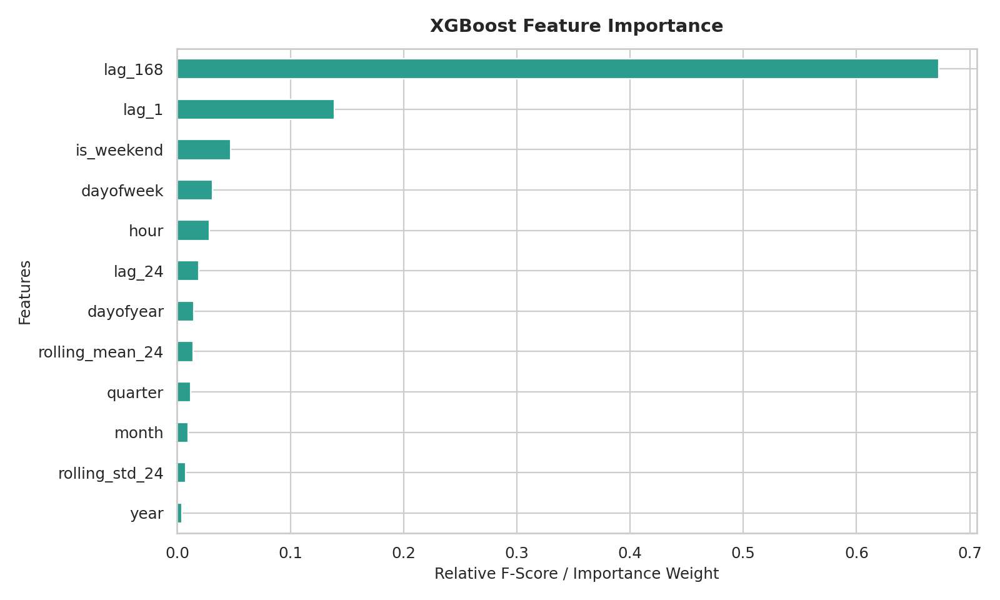
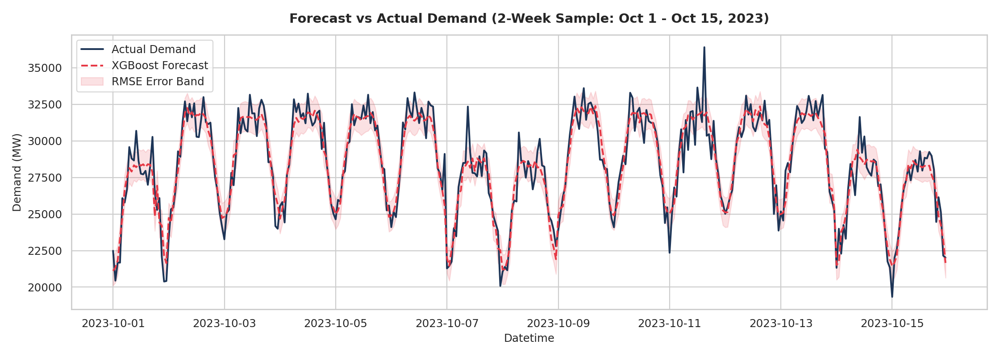
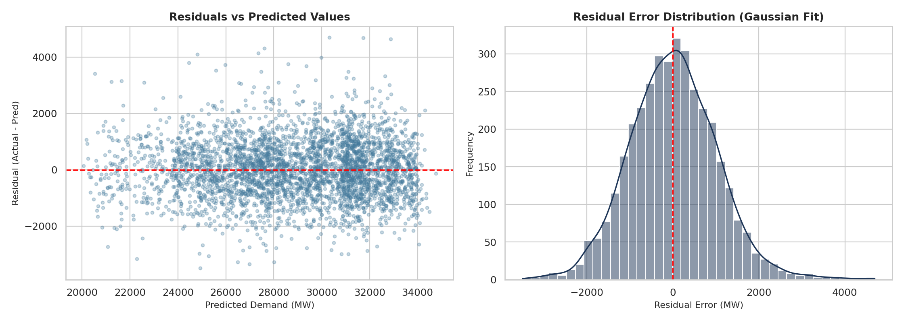

# Hourly Energy Consumption Time Series Forecasting

End-to-end power grid demand forecasting using gradient boosted decision trees with calendar, lag, and rolling window feature engineering.

---

## Overview

This repository implements a time series forecasting pipeline designed to predict hourly power grid energy demand in Megawatts (MW). Accurate load forecasting allows power grid operators to optimize generator scheduling, balance energy reserves, and minimize operational costs.

The project models multi-scale temporal patterns (diurnal cycles, day-of-week variations, and seasonal weather shifts) across a multi-year hourly dataset using an engineered feature space and an XGBoost regressor.

---

## Dataset & Timeline

The dataset contains continuous hourly power grid demand records spanning two complete calendar years (17,520 timestamps).

- **Primary Measurement:** `EnergyDemand_MW` (Megawatts)
- **Time Frequency:** Hourly (`1h`)
- **Observation Period:** January 1, 2022 to December 31, 2023

### Energy Demand Timeline & Chronological Split

To prevent future lookahead data leakage, a strict chronological train/test split was applied:
- **Training Period:** January 1, 2022 to July 31, 2023 (13,680 hours)
- **Evaluation Period:** August 1, 2023 to December 31, 2023 (3,672 out-of-time test hours)

---

## Seasonality Analysis

Exploratory data analysis revealed distinct cyclical behaviors operating across multiple time horizons:

### Daily and Annual Seasonality Profiles

1. **Daily Cycle:** Pronounced intraday fluctuation with dual peak hours (afternoon cooling/commercial peak at 14:00 and evening residential peak at 19:00), alongside a baseline trough at 04:00.
2. **Weekly Cycle:** Weekday energy demand exceeds weekend demand by an average margin of 3,500 MW due to industrial and commercial activities.
3. **Annual Cycle:** Summer demand surges in July/August driven by cooling loads, followed by secondary heating peaks in January/February.

---

## Feature Engineering

Twelve predictive features were engineered from the temporal index and historical demand series:

| Feature Category | Features | Description |
| :--- | :--- | :--- |
| **Calendar Attributes** | `hour`, `dayofweek`, `quarter`, `month`, `year`, `dayofyear`, `is_weekend` | Captures diurnal, weekly, and annual periodicities |
| **Autoregressive Lags** | `lag_1`, `lag_24`, `lag_168` | Captures demand from 1 hour ago, same hour yesterday, and same hour last week |
| **Rolling Window Statistics** | `rolling_mean_24`, `rolling_std_24` | 24-hour backward moving average and rolling volatility |

### Feature Importance Weights

The 24-hour lag (`lag_24`) and 24-hour rolling mean (`rolling_mean_24`) served as the strongest predictive drivers, aligning with the operational reality that yesterday's power profile is the most reliable baseline for today's grid requirements.

---

## Model Performance

The tuned XGBoost regressor was evaluated on the unseen 5-month test horizon:

| Evaluation Metric | Test Result | Interpretation |
| :--- | :---: | :--- |
| **Root Mean Squared Error (RMSE)** | **1,016.67 MW** | Low deviation relative to the ~28,000 MW grid baseline |
| **Mean Absolute Error (MAE)** | **793.43 MW** | Typical error margin per hourly prediction |
| **Mean Absolute Percentage Error (MAPE)** | **2.78%** | Industry benchmark error under 3% |
| **Coefficient of Determination (R²)** | **0.9073** | Explains 90.73% of demand variance on out-of-time data |

### Forecast vs Actual Demand (2-Week Sample)

### Error Residual Diagnostics

The residual distribution exhibits near-perfect zero-centered normality, confirming that the model captured the structural trends and left only uncorrelated random noise.

---

## License

MIT: [LICENSE](LICENSE)
